# Architecture, workflow and assumptions

## 1. Problem first

Procurement reviewers lose time on **evidence gathering** (is there a tool already? is there budget? is the vendor's
security review current? which approvals does this need?) and on **inconsistent routing** (the wrong approver, a missed
Security/Privacy/Legal review). The decision itself - approve, refuse, grant an exception - must stay human.

So the product is a **triage copilot**: it assembles evidence, applies the policy exactly, flags what is missing,
conflicting or unverifiable, and hands a structured package to the right humans. It never approves or buys.

| Layer | Owns | Why |
|---|---|---|
| **Code** | thresholds, budget arithmetic, 365-day review currency (vs. the policy reference date 2026-09-30), review triggers, injection scan, label floor, output validation | Must be exact, repeatable and auditable. An LLM adds nothing here and can only make it less reliable. |
| **AI** | reading free text (hidden PII/source-code/secrets mentioned in the justification), judging whether an existing tool is a credible alternative, writing the next step in plain language | Language understanding is the one thing code cannot do. |
| **Human** | every approval, every exception, the final purchase | Policy section 11. `human_review_required` is hard-wired to `true`. |

## 2. Workflow

```mermaid
flowchart LR
    U[Reviewer UI<br/>Streamlit] -->|request id / form| H["handle_request(request_id, architecture)"]
    H --> R{architecture}

    subgraph A["A - Single agent (2 LLM calls typical)"]
        A1[Agent: reads request,<br/>calls all tools in parallel,<br/>submits structured decision]
    end
    subgraph B["B - Staged (3 LLM calls typical)"]
        B1[Agent 1 Evidence analyst<br/>tools + data-class inference]
        B2[Agent 2 Policy reviewer<br/>no tools; challenges Agent 1]
        B1 -->|evidence brief +<br/>deterministic policy result| B2
    end
    R -->|single| A1
    R -->|staged| B1

    subgraph T["Shared tools (7)"]
        T1[get_request_context]:::det
        T2[check_budget]:::det
        T3[find_existing_software]:::det
        T4[get_purchase_history]:::det
        T5[lookup_vendor_registry]:::det
        T6[get_vendor_risk<br/>external mock API]:::ext
        T7[evaluate_policy<br/>rules engine]:::det
    end
    A1 <--> T
    B1 <--> T

    A1 --> G
    B2 --> G
    G["Guardrails (code)<br/>• model may only ADD flags/approvals/missing info<br/>• label never less strict than rules<br/>• evidence kept only if grounded in tool output<br/>• human_review_required = true"] --> D[ProcurementDecision]
    D --> UI2[Evidence panel + recommendation<br/>+ human decision log]

    classDef det fill:#e6f4ea,stroke:#1a7f37;
    classDef ext fill:#fff4e5,stroke:#bc4c00;
```

Both architectures share **the same tools, rules engine, guardrails and output schema**. The experiment therefore
isolates one question: *does splitting the model work across two agents improve the outcome enough to justify the extra
calls, tokens and latency?*

### Tools

| Tool | Kind | Returns |
|---|---|---|
| `get_request_context` | deterministic CSV lookup | requester, manager, department head (first Director/VP in the management chain) |
| `check_budget` | deterministic arithmetic | available budget, within-budget, shortfall |
| `find_existing_software` | deterministic catalog match | same product / vendor / category candidates, whether scope covers the requester's department |
| `get_purchase_history` | deterministic CSV lookup | previous purchases with the vendor |
| `lookup_vendor_registry` | deterministic CSV lookup | procurement / security / legal status + review date |
| `get_vendor_risk` | **external API** (mock service) | `ok` / `not_found` / `unavailable` envelope - failures are returned, never raised or hidden; one retry |
| `evaluate_policy` | deterministic rules engine | approvals, risk flags, missing info, data classes, baseline label, findings with policy references |

Tool arguments are *bound to the real request*: omitted arguments default to it, and `evaluate_policy` always re-derives
its inputs from the request, so a wrong (or injected) argument can never alter a policy outcome.

### Failure and adversarial handling

| Situation | Behaviour |
|---|---|
| Vendor-risk API 503 / timeout / connection error | `vendor_risk_unavailable` + `security_review_required`; label *Escalate to Security*; evidence says "NOT verified" |
| Vendor missing from API (404) or registry | treated as unverifiable / new vendor; Security + Legal |
| Registry vs API disagree (e.g. SignalWatch) | `conflicting_vendor_evidence` surfaced, neither silently preferred; Security |
| Review older than 365 days at 2026-09-30 | `vendor_review_expired`; date arithmetic is independent of the status label |
| Instruction-like text in request, registry, API or catalog notes | `prompt_injection_detected`, text ignored, normal policy applied; scanned in code, not by the model |
| LLM provider error / no final answer | automatic fallback to the rules-only result (`mode: deterministic-fallback`, 0 extra risk) |
| Model tries to relax a decision | label is raised to the rule baseline; removed items are restored; logged in `telemetry.agent_notes` |
| Model invents a number or cites a tool it never called | evidence item dropped, counted in `telemetry.ungrounded_evidence_dropped` |

## 3. Assumptions

| # | Assumption | Impact if wrong |
|---|---|---|
| A1 | The reference date is **2026-09-30** (policy header); the system clock is never used. | Review-currency results shift. |
| A2 | "Department head" = first Director/VP in the requester's management chain. Sales and Customer Success have no Director in their own department, so the chain (Go To Market Director) is the only usable source. | Wrong person named in the UI; approval *role* is unaffected. |
| A3 | `data_access_level` + `requested_integrations` are the authoritative structured data classification; free text may only *add* classes (via the model). | Under-classified requests rely on the model noticing (see case SY-07). |
| A4 | "Operating region" is not defined in the data; the vendor service flag `stores_data_outside_region` is taken as "outside the operating region". | Privacy/Legal over- or under-trigger for some vendors. |
| A5 | A same-vendor, same-category catalog entry that covers the requester's department counts as overlap unless the request is an explicit expansion (add-on / additional seats). | Possible false overlap flag on upgrades (REQ-1007); mitigated because overlap alone only routes to Procurement. |
| A6 | Overlap is **not** a rejection (policy section 3): it adds Procurement and a "justify the gap" next step. | - |
| A7 | No utilisation data exists, so "unused existing capacity" cannot be assessed; this is reported as unknown, not guessed. | - |
| A8 | A request with an unknown annual cost shows the approval floor (Manager + Procurement) and states the tier cannot be finalised. | - |

## 4. Starter-pack issues found and fixed

| Issue | Fix |
|---|---|
| `pandas.read_csv` turns empty cells (e.g. `security_review_date`, `manager_id`) into `float('nan')`, which is truthy, not JSON-serialisable and defeats `is None` checks | `data_access.py` reads text with `keep_default_na=False` and converts numeric columns explicitly |
| `run_local.py` launches Streamlit without `--server.headless`; a first-time run blocks on an interactive e-mail prompt so the command appears to hang | headless + usage-stats flags added |
| `vendor_client.get_vendor_risk` raises on 404/503 and has no retry or "unavailable" semantics | `fetch_vendor_risk` wrapper returns a typed envelope; the raw function is kept |
| Nothing starts the mock API for the eval runner / `handle_request` from a clean checkout | `ensure_mock_api()` starts the same FastAPI app in-process when localhost is unreachable (disable with `AUTOSTART_MOCK_API=0`) |
| `.gitignore` ignored every `evals/results_*.csv`, so result files could not be part of the submission | results are written under tracked `evals/results/` |
| No LLM SDK in `requirements.txt`; `use_container_width` deprecated in the starter UI | provider code + dependency added; UI rewritten |
| Registry/API deliberately disagree for SignalWatch (registry "Approved 2025-07-01", API "expired") | not a bug - handled as `conflicting_vendor_evidence` + `vendor_review_expired` |
